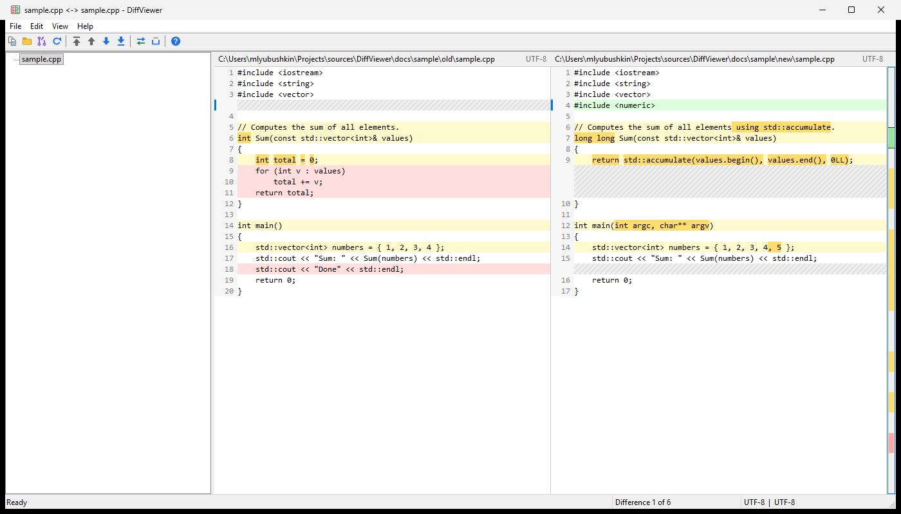

# DiffViewer

A small native Windows (Win32, C++17) side-by-side diff viewer built on the
[Yaswl](https://github.com/Clipeus/RichEditSDI/tree/main/Yaswl) header-only library.



* **Left**: a tree of compared files (added / removed / modified / identical are colored).
* **Right**: two synchronized panes with line numbers, colored rows, word-level
  highlights inside changed lines, filler rows for alignment and an overview map on the right edge.

## What can be compared

| Mode | How |
|------|-----|
| Two files | `File > Compare Files...` (Ctrl+O), drop two files on the window, or `DiffViewer.exe a.txt b.txt` |
| Two folders | `File > Compare Folders...` (Ctrl+D), drop two folders, or `DiffViewer.exe dirA dirB` |
| GitHub pull request | `File > Open Pull Request...` (Ctrl+P) or `DiffViewer.exe https://github.com/owner/repo/pull/606` |

Pull requests are read through the GitHub REST API. For private repositories the token is taken
from the `GITHUB_TOKEN` / `GH_TOKEN` environment variable or, if neither is set, from
`gh auth token` (the GitHub CLI). GitHub Enterprise hosts are supported (`https://host/owner/repo/pull/N`).
The left side is the merge base of the PR, the right side is the PR head, so the diff matches the "Files changed" tab.

## Keys

| Key | Action |
|-----|--------|
| F8 / Shift+F8 | Next / previous difference (also Alt+Down / Alt+Up) |
| Ctrl+F8 / Ctrl+Shift+F8 | First / last difference |
| F5 | Refresh |
| Ctrl+C | Copy selected lines of the active pane (click-drag or Shift+click to select) |
| Ctrl+A | Select all lines of the active pane |
| Shift+wheel | Horizontal scroll |

`View > Ignore Whitespace` compares lines with collapsed whitespace; `View > Show Identical Files`
toggles identical files in folder / PR trees; `View > Swap Sides` swaps left and right.

## Building

Open `DiffViewer.sln` in Visual Studio 2022 (toolset v143, Windows 10 SDK) and build, or:

```
msbuild DiffViewer.sln -p:Configuration=Release -p:Platform=x64
```

The binary is `x64\Release\DiffViewer.exe` and has no dependencies besides Windows.
Sample files for a quick try live in `docs\sample`:

```
x64\Release\DiffViewer.exe docs\sample\old docs\sample\new
```

Icons in `sources\res` are generated by `python tools\make_icons.py` (requires Pillow).

## Project layout

```
Yaswl/                 header-only window library (copied from Clipeus/RichEditSDI)
sources/
  DiffEngine.*         Myers diff (linear space) + row model + word-level intra-line diff
  DiffView.*           owner-drawn side-by-side control
  CompareSession.*     file pair / folder / pull request sessions (tree model + loading)
  GitHub.*, Json.*     GitHub REST client on WinHTTP with a tiny JSON reader
  TextFile.*           file reading, BOM / UTF-8 / ANSI detection, binary detection
  MainWnd.*            main frame: toolbar, tree, splitter, status bar, commands
  Dialogs.*            Compare / Pull Request / About dialogs
```
